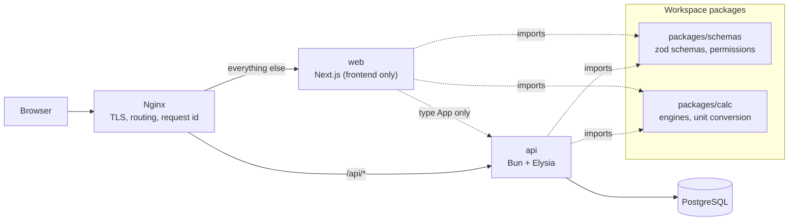
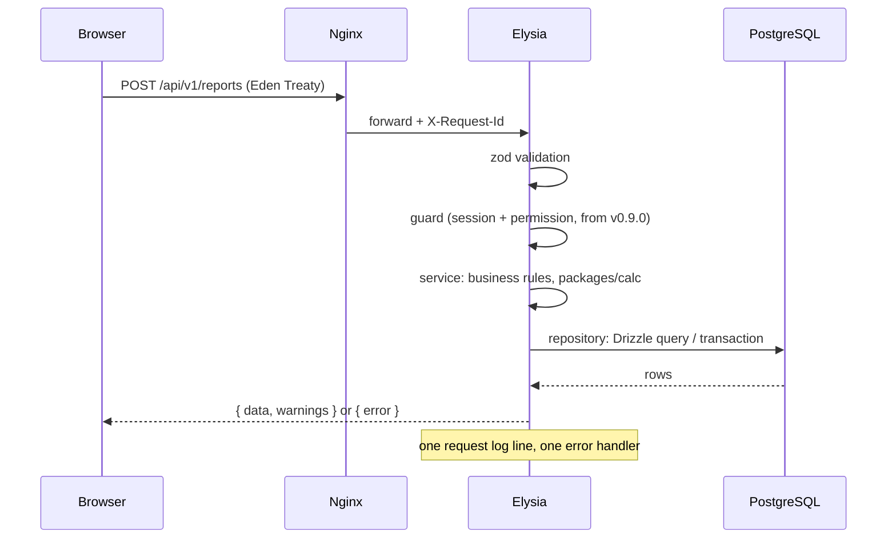

# 01 — Architecture Overview

DMR Online replaces the macro Excel workbook described in `DMR_Workbook_Analysis.md`. This document shows the parts of the system and how a request moves through them.

## Scope and assumptions

- Web application, **online only**. Offline entry is parked.
- **One company**, many projects and wells. An engineer works on the wells assigned to them.
- UI language **English**, **Gregorian** calendar. A Persian calendar comes in a later release.
- Values are **stored in SI** and converted for display.
- A report **stays editable after submit**.
- Mud systems: water-based and brine first; oil-based later.

## Containers

| Part | Responsibility |
|---|---|
| Nginx | TLS, one domain, routes `/api/*` to the API and the rest to the web app, adds `X-Request-Id` |
| web | Pages, forms, tables, printing. Holds no business rules except live preview through `packages/calc` |
| api | Validation, permissions, business rules, persistence, stored results |
| PostgreSQL | The only store. History lives here |
| `packages/schemas` | zod schemas shared by forms and routes; permission map |
| `packages/calc` | Pure calculation functions and unit conversion. No I/O |

There is **one API service** (a modular monolith). Features are separated as modules inside it, not as separate services.

## Request flow

Inside the API every module has three layers: `routes` (HTTP only) → `service` (rules) → `repository` (SQL). See `02-folder-structure.md`.

## Design principles

1. **Derive, do not store.** Stock, section / monthly / well totals, start volume and cumulative hours are queries over earlier reports. The workbook's state block and its New Month / New Section macros have no equivalent table.
2. **Snapshot what was printed.** When a report is submitted, the calculated results are stored with an engine version. See point 4.
3. **SI at rest.** The database and the API carry SI values. Conversion happens in one place (`packages/calc/units`), at the edge.
4. **Editing a report recalculates what depends on it.** A submitted report can be edited. An edit raises its `revision`, rewrites its result snapshot, and marks the snapshots of all later reports of the same well as stale so they are recalculated.
5. **Warn like the workbook, but record it.** Volume imbalance and negative stock are warnings the user must acknowledge, not hard errors.
6. **Same engine on both sides.** The browser runs `packages/calc` for live preview; the API runs the same code for the stored result.
7. **Identity by ID.** Products, pits and equipment are rows with UUIDs. Nothing depends on row position.

## Document map

| # | Document | Answers |
|---|---|---|
| 02 | Folder structure | Where does this file go? |
| 03 | Database schema and migrations | What is stored and how does it change? |
| 04 | API conventions | What does a route look like? |
| 05 | Error flow | What happens when something fails? |
| 06 | Logging | What is written to the logs? |
| 07 | Authentication and authorization | Who may do what? |
| 08 | Calculation engine spec | Which functions exist and how are they checked? |
| 09 | Testing strategy | What must be tested? |
| 10 | Git workflow | How does a task become one clean commit? |
| 11 | Environments and deployment | How is it run and released? |
| 12 | Roadmap and release plan | In what order is it built? |
