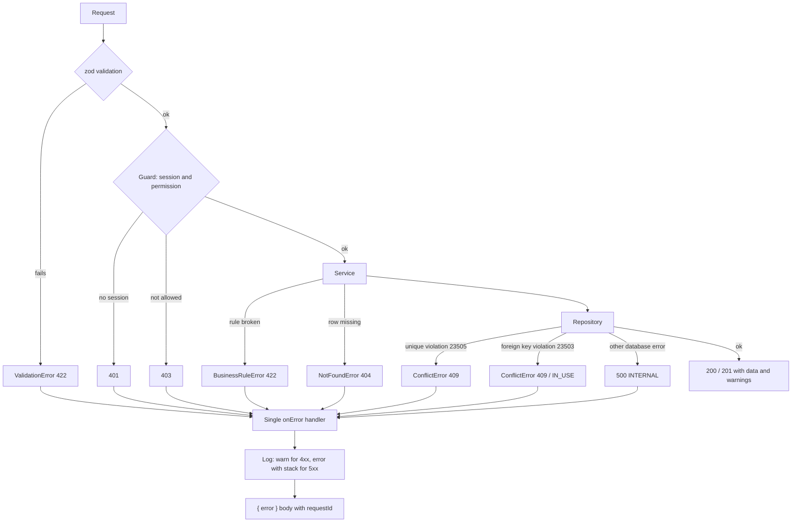

# 05 — Error Flow

One way to raise an error, one place where it becomes a response, one shape the frontend handles.

## Three kinds of problem

| Kind | Example | Result |
|---|---|---|
| **Error** | Invalid body, row not found, duplicate report date, no permission | Request fails; `{ error }` |
| **Warning** | Volume books do not balance, a product's stock goes negative | Request succeeds; `{ data, warnings }`. Submitting needs an explicit acknowledgement |
| **Bug** | Unexpected exception | `500 INTERNAL`, generic message, full detail in the log |

Warnings exist because the workbook lets the engineer continue after "Fluid volume is not balanced" and "Final stock is not valid". The online version keeps that behaviour and records the acknowledgement.

## Error classes (`apps/api/src/lib/errors.ts`)

All extend `AppError { code, status, message, details? }`.

| Class | Status | Code |
|---|---|---|
| `ValidationError` | 422 | `VALIDATION_FAILED` |
| `UnauthenticatedError` | 401 | `UNAUTHENTICATED` |
| `ForbiddenError` | 403 | `FORBIDDEN` |
| `NotFoundError` | 404 | `NOT_FOUND` |
| `ConflictError` | 409 | `CONFLICT` |
| `RevisionMismatchError` | 409 | `REVISION_MISMATCH` |
| `BusinessRuleError` | 422 | a specific code, see below |
| `UpstreamError` | 502 | `PDF_RENDER_FAILED` (the PDF renderer failed or timed out; since v1.1.0) |
| `ServiceUnavailableError` | 503 | `SERVICE_UNAVAILABLE` (a dependency such as the database is down; health check) |
| anything else | 500 | `INTERNAL` |

Business-rule codes (grow this list, never reuse a code):

| Code | Meaning |
|---|---|
| `REPORT_DATE_TAKEN` | A report already exists for this well and date |
| `REPORT_NOT_LATEST` | Action allowed only on the newest report of the well |
| `PIT_VOLUME_OVER_CAPACITY` | Reading above pit capacity |
| `MUD_WEIGHT_OUT_OF_RANGE` | Outside 0.5–2.6 × water density |
| `SURVEY_DEPTH_NOT_INCREASING` | Station depth not above the previous one |
| `BHA_TOOL_PRESSURE_REQUIRED` | Motor or downhole tool without a pressure loss |
| `WARNINGS_NOT_ACKNOWLEDGED` | Submit attempted with open warnings |
| `IN_USE` | Master row is referenced and cannot be deleted |

Warning codes: `VOLUME_NOT_BALANCED`, `NEGATIVE_STOCK`, `ACTIVITY_HOURS_NOT_24`, `SURVEY_NOT_UPDATED`.

## Response body

```jsonc
{
  "error": {
    "code": "VALIDATION_FAILED",
    "message": "Request validation failed",
    "details": [ { "path": "body.mudWeight", "message": "Expected number" } ],
    "requestId": "9f1c…"
  }
}
```

- `message` is safe to show to a user. It never contains SQL, stack traces or file paths.
- `details` is an array of `{ path, message }` for validation, an object for business rules.
- `requestId` is the value logged for the request.

## Flow in the API



Rules:

1. Code throws; it does not build error responses. The only place that writes an error body is the `error-handler` plugin (`onError`).
2. Repositories let database errors pass; the handler maps PostgreSQL codes. Services catch a database error only to give it a more specific business code.
3. A transaction that throws rolls back completely. No partial report is ever saved.
4. Unknown errors are logged with the stack and answered with `INTERNAL` and a fixed message.

## Submit and warnings

1. Any save of a report returns the current `warnings`.
2. `POST /reports/:id/submit` with open warnings and without `acknowledgeWarnings: true` fails with `WARNINGS_NOT_ACKNOWLEDGED`, listing them in `details`.
3. With the flag, the report is submitted and the acknowledged warning codes are stored on the report.

## Flow in the frontend

| Error | Handling |
|---|---|
| `VALIDATION_FAILED` | Map `details[].path` to TanStack Form fields; focus the first one |
| Business-rule codes | Message next to the field or section the rule belongs to |
| `REVISION_MISMATCH` | Dialog: "This report was changed by someone else", with a reload button |
| `UNAUTHENTICATED` | Redirect to login, keep the return address (from v0.9.0) |
| `FORBIDDEN` | Toast; the control should not have been visible |
| `NOT_FOUND` on a page | Not-found page |
| `INTERNAL`, network failure | Toast with the `requestId`; the form keeps its values |
| Render error | React error boundary per page section |

Eden Treaty returns `{ data, error }`. Feature hooks turn `error` into a thrown `ApiError` so TanStack Query's `onError` and error states work the normal way. Queries retry network failures twice; mutations never retry automatically.

Warnings are shown in a panel on the report page with the numbers from `details` (which item is off, and by how much).
