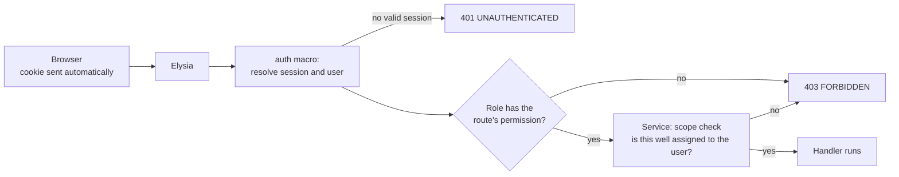

# 07 — Authentication and Authorization

Decided: **better-auth**, session in an **httpOnly cookie**, **RBAC**. Built in **v0.9.0**.

Code-level details of better-auth (option names, plugin APIs, generated table names) must be read from its current documentation when v0.9.0 starts. This document fixes the behaviour, not the API calls.

## Before v0.9.0

There is no login. Therefore:

1. The deployment is not reachable from the public internet (Nginx basic auth, an IP allow-list, or a VPN).
2. Every table has nullable `created_by` / `updated_by`.
3. Every route already declares the permission it will need. The `guard` plugin accepts everything until v0.9.0.

## Authentication

| Topic | Decision |
|---|---|
| Method | Email and password |
| Sign-up | Closed. An admin creates users |
| Session | Stored in the database by better-auth; the browser holds only a cookie |
| Cookie | `HttpOnly`, `Secure`, `SameSite=Lax`, path `/` |
| Lifetime | 7 days, renewed on activity (confirm when implementing) |
| Password reset | By an admin in the first version; email reset later if a mail service is added |
| Integration | better-auth handler mounted in Elysia; Drizzle adapter on the same PostgreSQL database |
| Tables | Generated by the better-auth CLI and added to the Drizzle schema through a normal migration |
| Frontend | better-auth client for sign-in, sign-out and the current session |

Because web and API share one domain behind Nginx, there is no CORS and the cookie is first-party.

### Request path

## Authorization (RBAC)

A user has **one role**. A role has a fixed set of **permissions**. Routes ask for a permission, never for a role.

### Roles

| Role | Who |
|---|---|
| `admin` | System owner. Users, projects, everything |
| `coordinator` | Office. All wells, master data, prices, recap |
| `engineer` | Fluids engineer at the rig. Reports of assigned wells |
| `client` | Operator or contractor representative. Read only, assigned wells |

### Permission matrix (starting point; confirm at v0.9.0)

| Permission | admin | coordinator | engineer | client |
|---|---|---|---|---|
| `user:manage` | ✔ | | | |
| `project:manage` | ✔ | ✔ | | |
| `well:manage` | ✔ | ✔ | | |
| `well:assign` | ✔ | ✔ | | |
| `master:manage` (pits, pumps, equipment, products) | ✔ | ✔ | ✔ own wells | |
| `price:manage` | ✔ | ✔ | | |
| `report:read` | ✔ | ✔ | ✔ own wells | ✔ own wells, submitted only |
| `report:write` (create, edit draft) | ✔ | | ✔ own wells | |
| `report:submit` | ✔ | | ✔ own wells | |
| `report:edit_submitted` | ✔ | ✔ | ✔ own wells | |
| `report:delete` | ✔ | | ✔ own wells, latest draft only | |
| `recap:read` | ✔ | ✔ | ✔ own wells | ✔ own wells |
| `cost:read` | ✔ | ✔ | ✔ | as printed on the report |
| `audit:read` | ✔ | ✔ | | |

### Scope

"Own wells" comes from `well_members (user_id, well_id)`. `admin` and `coordinator` are not limited by it.

The check has two steps on purpose:

1. **Permission** — in the guard, from the role. Cheap, needs no database row.
2. **Scope** — in the service, because it needs the well of the record being touched.

### Where the rules live

- `packages/schemas/permissions.ts` holds the role → permission map. The API enforces it; the web app uses the same map to hide controls.
- Hiding a control is convenience. The API check is the rule.
- Whether to use a better-auth access-control plugin or this plain map is decided in v0.9.0. Default: the plain map, because it is small and easy to read.

## Editing after submit and the audit log

A submitted report stays editable for roles with `report:edit_submitted`. Every such edit writes an `audit_log` row: user, time, report, revision before and after, and the changed fields. The report page shows "edited after submit" with the last editor and time.

## Security checklist

- [ ] Cookie flags as above; `Secure` everywhere except local development.
- [ ] CSRF: state-changing requests are accepted only from the application's own origin (better-auth trusted origins plus an `Origin` check for the rest of the API).
- [ ] Rate limit on sign-in.
- [ ] Passwords: minimum length 10; hashing left to better-auth.
- [ ] Secrets only in environment variables; `.env` never committed.
- [ ] Nginx: HTTPS only, HSTS, `X-Content-Type-Options: nosniff`, `frame-ancestors 'none'`, request body limit.
- [ ] No CORS headers (same origin).
- [ ] Error messages do not reveal whether an email exists.
- [ ] Sessions of a deactivated user are revoked.
- [ ] `bun audit` (or equivalent) in CI.

## Tasks for v0.9.0 (become issues when the version starts)

1. better-auth setup, tables, migration.
2. Sign-in / sign-out pages, session hook, route protection in the web app.
3. Guard: session resolution and permission check; replace the open guard.
4. `well_members` and scope checks in services.
5. User management screens (admin).
6. Fill `created_by` / `updated_by`; add the foreign keys.
7. `audit_log` and the "edited after submit" indicator.
8. Remove the temporary Nginx access restriction.
