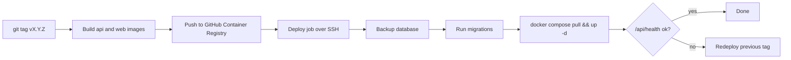

# 11 — Environments and Deployment

## Environments

| Environment | Where | Data | Purpose |
|---|---|---|---|
| `local` | Developer machine, Docker Compose | Demo seed | Development |
| `ci` | GitHub Actions | Temporary PostgreSQL service | Checks on every pull request |
| `production` | One server, Docker Compose | Real | Users |

A staging environment is added only when more than one person deploys, or when real wells are running and a release needs a rehearsal.

## Configuration

All configuration is environment variables, validated with zod in `apps/api/src/config/env.ts`. The API refuses to start if one is missing or malformed. `.env.example` lists every variable; `.env` is never committed.

| Variable | Used by | Example | Since |
|---|---|---|---|
| `NODE_ENV` | api, web | `production` | v0.1.0 |
| `API_PORT` | api | `3001` | v0.1.0 |
| `DATABASE_URL` | api | `postgres://ddr:…@postgres:5432/ddr` | v0.1.0 |
| `LOG_LEVEL` | api | `info` | v0.1.0 |
| `POSTGRES_USER`, `POSTGRES_PASSWORD`, `POSTGRES_DB` | postgres | | v0.1.0 |
| `POSTGRES_HOST_PORT` | postgres (local Compose) | `5432` | v0.1.0 |
| `NGINX_HOST_PORT` | nginx (local Compose) | `80` | v0.1.0 |
| `APP_ORIGIN` | api | `https://ddr.example.com` (default `http://localhost`) | v0.9.0 |
| `BETTER_AUTH_SECRET` | api | at least 32 random characters; required in production | v0.9.0 |
| `BETTER_AUTH_URL` | api | the application origin when not set | v0.9.0 |
| `ADMIN_EMAIL`, `ADMIN_PASSWORD` | `db:seed:admin` | first administrator; password of at least 10 characters | v0.9.0 |

## Containers

| Service | Image | Notes |
|---|---|---|
| `nginx` | `nginx:1.30.6-trixie` | Ports 80 / 443; TLS; `/api/` → `api:3001`, `/` → `web:3000`; sets `X-Request-Id`. Config: `infra/nginx/templates/` |
| `web` | built from `apps/web/Dockerfile` | Built with Bun, runs on Node LTS, Next.js standalone output; non-root user |
| `api` | built from `apps/api/Dockerfile` | Bun; runs as a non-root user; health check `/api/health` |
| `postgres` | `postgres:18.6-bookworm` | Named volume; not published to the host in production |

Local development always goes through Nginx at `http://localhost`, so web and API share one origin as in production:

- `docker compose up -d postgres nginx`, then `bun run dev` (api and web on the host, fast reload). Nginx forwards to the Compose containers when they run and otherwise to the same ports on the host (`host.docker.internal`).
- `docker compose up -d --build` runs the full set to check the production-like wiring.

Dockerfiles are multi-stage: install with the lockfile, build, copy only what runs. Images are tagged with the Git tag and the commit SHA.

## CI (every pull request)

1. `bun install --frozen-lockfile`
2. `bun run lint` (Biome)
3. `bun run typecheck`
4. `bun test` (with a PostgreSQL service container; migrations and demo seed applied)
5. `bun run build` (api and web)

Steps 2–5 are four jobs (`lint`, `typecheck`, `test`, `build`) in `.github/workflows/ci.yml`; each starts with step 1. All four are required status checks on `main`, and a branch must be up to date with `main` before it can merge.

## Release (on tag `v*`)



- Migrations run before the new containers start and are backward compatible (see `03-database-schema-and-migrations.md`), so rolling back means redeploying the previous image tag.
- Deploy secrets (SSH key, registry token, production `.env`) live in GitHub Actions secrets and on the server, nowhere else.

## Backups

| Item | Rule |
|---|---|
| What | `pg_dump --format=custom` of the whole database |
| When | Nightly, and before every deploy |
| Kept | 14 daily, 8 weekly |
| Where | On the server **and** copied off the server |
| Test | Restore into a scratch database once per release from v1.0.0 |

`infra/scripts/backup.sh` and `restore.sh` are the only supported way. A backup that has never been restored does not count.

| Script | What it does |
|---|---|
| `backup.sh [daily\|predeploy]` | `pg_dump --format=custom` into `BACKUP_DIR` (default `./backups`), reads the dump back with `pg_restore --list` before keeping it, keeps the newest 14 dumps and 8 weekly copies, then runs `BACKUP_COPY_CMD` for the off-server copy (for example `rclone copy "$FILE" remote:ddr-backups`). |
| `restore.sh <dump> [database]` | Restores into a **new** database (default `ddr_restore_<time>`); it refuses to overwrite an existing one. To replace the live database: stop the api, drop it yourself, restore under its name. |
| `verify-restore.sh [dump]` | Restores the newest dump into a scratch database, compares the row count of every table with the live database, drops the scratch database. Exit 0 only if all counts match (`VERIFY_ALLOW_NEWER=1` accepts higher live counts). Run it once per release. |

The scripts reach PostgreSQL through `PG_EXEC` (default `docker compose exec -T postgres`; with podman: `PG_EXEC="podman exec -i postgres"`). Nightly run on the server, as the deploy user:

```
15 2 * * *  cd /srv/ddr && BACKUP_COPY_CMD='rclone copy "$FILE" remote:ddr-backups' infra/scripts/backup.sh daily
```

## Access

Since v0.9.0 the application has its own sign-in (docs/07): every route needs a session and a permission, so the temporary Nginx restriction (basic auth, IP allow-list or VPN) is no longer required. Create the first administrator with `bun run db:seed:admin` (`ADMIN_EMAIL`, `ADMIN_PASSWORD`) before the first sign-in; set `BETTER_AUTH_SECRET` (the API refuses the development secret in production) and `APP_ORIGIN` to the public origin.

## TLS and domain

HTTPS only, certificate from Let's Encrypt renewed automatically, HTTP redirected to HTTPS. Security headers are listed in `07-authentication-and-authorization.md`.

Files: `docker-compose.prod.yml` (images from the registry, Postgres not published, `certbot` service that renews twice a day), `infra/nginx/prod/default.conf.template` (80 → 443, TLS 1.2 / 1.3, HSTS and the other headers), `infra/scripts/init-tls.sh` (first certificate).

## First deployment of a server

1. Server basics (see "Health and operations"), a deploy user in the `docker` group, `/srv/ddr` owned by it.
2. `/srv/ddr/.env` with `IMAGE_REPO` (`ghcr.io/<owner>/<repo>`, lower case), `DOMAIN`, `APP_ORIGIN` (`https://<DOMAIN>`), `LETSENCRYPT_EMAIL`, `POSTGRES_USER`, `POSTGRES_PASSWORD`, `POSTGRES_DB`, `BETTER_AUTH_SECRET` (`openssl rand -base64 48`), and `ADMIN_EMAIL`, `ADMIN_PASSWORD` for the first administrator.
3. The DNS record of `DOMAIN` points at the server. Copy `docker-compose.prod.yml` and `infra/` to `/srv/ddr` (the release workflow does it on every deploy) and run `infra/scripts/init-tls.sh`.
4. GitHub: environment `production` with the secrets named in `.github/workflows/release.yml`.
5. Push a tag `vX.Y.Z`: the workflow builds, pushes and deploys. After the first deploy create the administrator: `docker compose -f docker-compose.prod.yml run --no-deps -e ADMIN_EMAIL -e ADMIN_PASSWORD api bun dist/seed-admin.js`, then sign in and create the other users.
6. Install the nightly backup cron line of "Backups" and run `infra/scripts/verify-restore.sh` once.

A deploy that fails its health check redeploys the previous tag (`infra/scripts/deploy.sh`). None of these files has run on a real server yet: the first deployment is the test, so do it before the week it is needed.

## Server setup (hardening)

On a fresh Debian or Ubuntu server, as root, once (adapt the user name):

```
adduser --disabled-password deploy && usermod -aG docker deploy
install -d -o deploy -g deploy /srv/ddr
# SSH keys only, no root login
sed -i 's/^#\?PasswordAuthentication.*/PasswordAuthentication no/; s/^#\?PermitRootLogin.*/PermitRootLogin no/' /etc/ssh/sshd_config
systemctl reload ssh
# firewall: SSH, HTTP (certificate challenge and redirect), HTTPS
ufw default deny incoming && ufw allow OpenSSH && ufw allow 80/tcp && ufw allow 443/tcp && ufw enable
# automatic security updates
apt-get install -y unattended-upgrades && dpkg-reconfigure -plow unattended-upgrades
```

PostgreSQL is not published to the host (`docker-compose.prod.yml`), so the firewall only needs the three ports above. Put the public key of the release workflow in `~deploy/.ssh/authorized_keys`.

## Onboarding a real well

The first well is entered in the application, in this order. Opening stock is a normal "received" on report 1 (docs/03), not a separate screen.

1. **Server:** the first administrator (see "First deployment") and the lookup lists: `docker compose -f docker-compose.prod.yml run --no-deps api bun dist/seed-lookups.js` (activities, sample sources, fluid systems, pit mud types; idempotent).
2. **Users:** sign in as the administrator, create the coordinator, the engineers and the client representatives on the `Users` page.
3. **Project:** name, operator, currency, and the display unit system (the workbook preset gives bbl, PCF, psi, m, gal/min, lb/bbl, °F). Then the rig equipment: pits, pumps, solids-control units. Then the product catalogue and the project's price list with the real prices; mark up to five products as key stock.
4. **Well:** name, type, rig type and the **spud date** (the date of report 1). Assign the engineers and clients on the well page (`Members`).
5. **Well data:** drilling sections (planned mud weight, yield point, fluid loss), the wellbore geometry, the drill string run and, for a directional well, the survey.
6. **Report 1:** `New report` proposes number 1 and the spud date. Enter the day as the workbook did; put the product stock the rig holds as **received** on report 1 (a negative value is a return), and the pit readings.
7. **Check against the workbook** for the first days: the printed page and the recap next to the workbook's. A difference larger than the workbook's own rounding (docs/08, "Decisions of v0.8.5") is a bug to report.
8. After a few reports run `infra/scripts/verify-restore.sh` and note the date.

## Health and operations

- `GET /api/health` returns 200 only if the database answers.
- Docker restart policy `unless-stopped`; container health checks on api and postgres.
- Logs: see `06-logging.md`.
- Server basics: firewall allowing 80 / 443 / SSH only, SSH keys only, automatic security updates.
