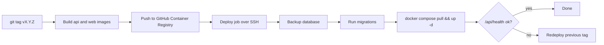

# 11 — Environments and Deployment

## Environments

| Environment | Where | Data | Purpose |
|---|---|---|---|
| `local` | Developer machine, Docker Compose | Demo seed | Development |
| `ci` | GitHub Actions | Temporary PostgreSQL service | Checks on every pull request |
| `production` | One server, Docker Compose | Real | Users |

A staging environment is added only when more than one person deploys, or when real wells are running and a release needs a rehearsal.

## Configuration

All configuration is environment variables, validated with zod in `apps/api/src/config/env.ts`. The API refuses to start if one is missing or malformed. `.env.example` lists every variable; `.env` is never committed.

| Variable | Used by | Example | Since |
|---|---|---|---|
| `NODE_ENV` | api, web | `production` | v0.1.0 |
| `API_PORT` | api | `3001` | v0.1.0 |
| `DATABASE_URL` | api | `postgres://ddr:…@postgres:5432/ddr` | v0.1.0 |
| `LOG_LEVEL` | api | `info` | v0.1.0 |
| `POSTGRES_USER`, `POSTGRES_PASSWORD`, `POSTGRES_DB` | postgres | | v0.1.0 |
| `POSTGRES_HOST_PORT` | postgres (local Compose) | `5432` | v0.1.0 |
| `NGINX_HOST_PORT` | nginx (local Compose) | `80` | v0.1.0 |
| `APP_ORIGIN` | api | `https://ddr.example.com` (default `http://localhost`) | v0.9.0 |
| `BETTER_AUTH_SECRET` | api | at least 32 random characters; required in production | v0.9.0 |
| `BETTER_AUTH_URL` | api | the application origin when not set | v0.9.0 |
| `ADMIN_EMAIL`, `ADMIN_PASSWORD` | `db:seed:admin` | first administrator; password of at least 10 characters | v0.9.0 |

## Containers

| Service | Image | Notes |
|---|---|---|
| `nginx` | `nginx:1.30.6-trixie` | Ports 80 / 443; TLS; `/api/` → `api:3001`, `/` → `web:3000`; sets `X-Request-Id`. Config: `infra/nginx/templates/` |
| `web` | built from `apps/web/Dockerfile` | Built with Bun, runs on Node LTS, Next.js standalone output; non-root user |
| `api` | built from `apps/api/Dockerfile` | Bun; runs as a non-root user; health check `/api/health` |
| `postgres` | `postgres:18.6-bookworm` | Named volume; not published to the host in production |

Local development always goes through Nginx at `http://localhost`, so web and API share one origin as in production:

- `docker compose up -d postgres nginx`, then `bun run dev` (api and web on the host, fast reload). Nginx forwards to the Compose containers when they run and otherwise to the same ports on the host (`host.docker.internal`).
- `docker compose up -d --build` runs the full set to check the production-like wiring.

Dockerfiles are multi-stage: install with the lockfile, build, copy only what runs. Images are tagged with the Git tag and the commit SHA.

## CI (every pull request)

1. `bun install --frozen-lockfile`
2. `bun run lint` (Biome)
3. `bun run typecheck`
4. `bun test` (with a PostgreSQL service container; migrations and demo seed applied)
5. `bun run build` (api and web)

Steps 2–5 are four jobs (`lint`, `typecheck`, `test`, `build`) in `.github/workflows/ci.yml`; each starts with step 1. All four are required status checks on `main`, and a branch must be up to date with `main` before it can merge.

## Release (on tag `v*`)

- Migrations run before the new containers start and are backward compatible (see `03-database-schema-and-migrations.md`), so rolling back means redeploying the previous image tag.
- Deploy secrets (SSH key, registry token, production `.env`) live in GitHub Actions secrets and on the server, nowhere else.

## Backups

| Item | Rule |
|---|---|
| What | `pg_dump --format=custom` of the whole database |
| When | Nightly, and before every deploy |
| Kept | 14 daily, 8 weekly |
| Where | On the server **and** copied off the server |
| Test | Restore into a scratch database once per release from v1.0.0 |

`infra/scripts/backup.sh` and `restore.sh` are the only supported way. A backup that has never been restored does not count.

## Access

Since v0.9.0 the application has its own sign-in (docs/07): every route needs a session and a permission, so the temporary Nginx restriction (basic auth, IP allow-list or VPN) is no longer required. Create the first administrator with `bun run db:seed:admin` (`ADMIN_EMAIL`, `ADMIN_PASSWORD`) before the first sign-in; set `BETTER_AUTH_SECRET` (the API refuses the development secret in production) and `APP_ORIGIN` to the public origin.

## TLS and domain

HTTPS only, certificate from Let's Encrypt renewed automatically, HTTP redirected to HTTPS. Security headers are listed in `07-authentication-and-authorization.md`.

## Health and operations

- `GET /api/health` returns 200 only if the database answers.
- Docker restart policy `unless-stopped`; container health checks on api and postgres.
- Logs: see `06-logging.md`.
- Server basics: firewall allowing 80 / 443 / SSH only, SSH keys only, automatic security updates.
