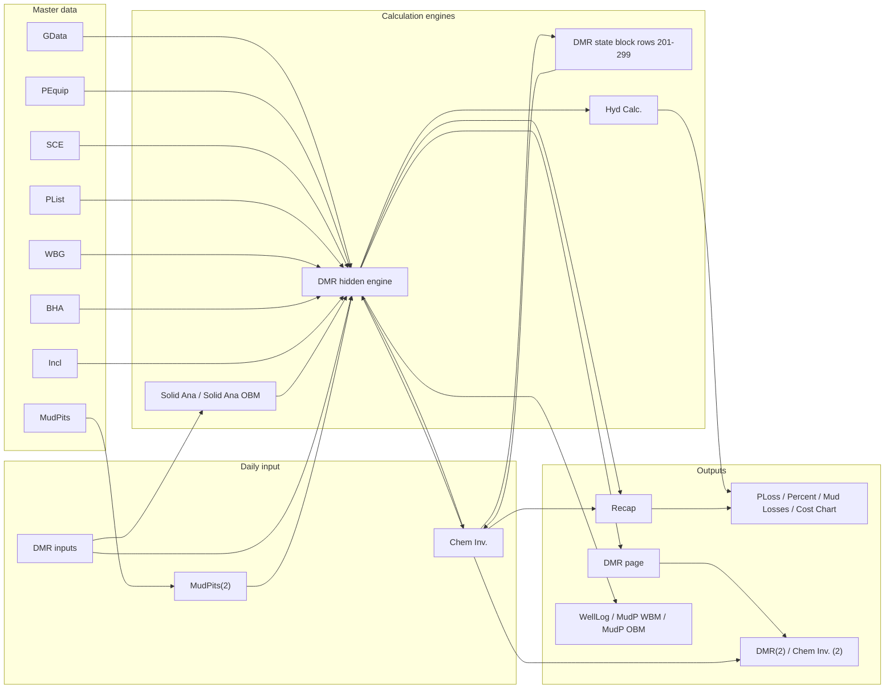
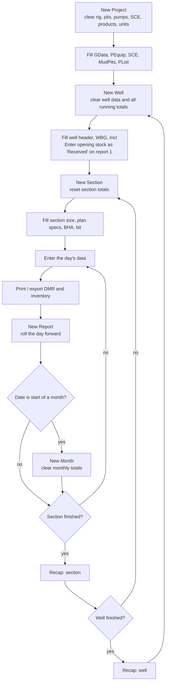
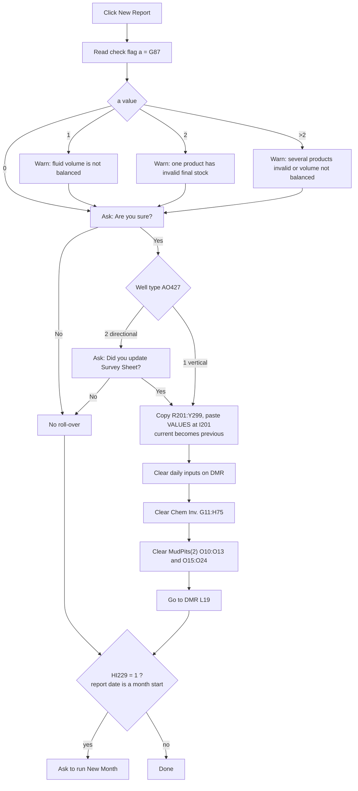
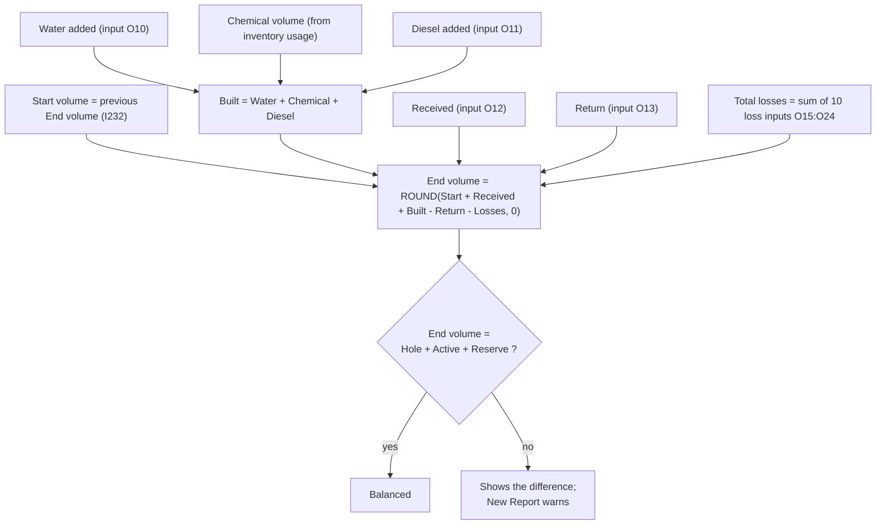
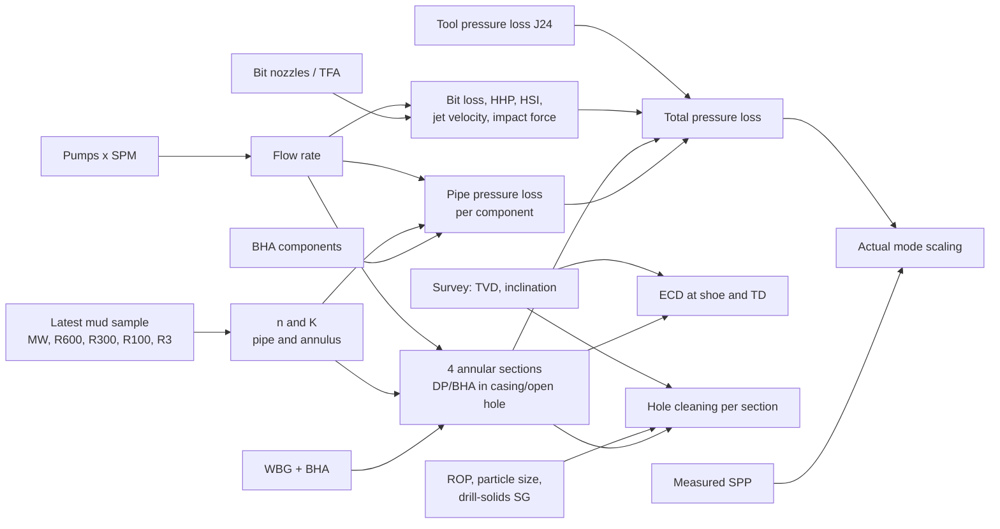
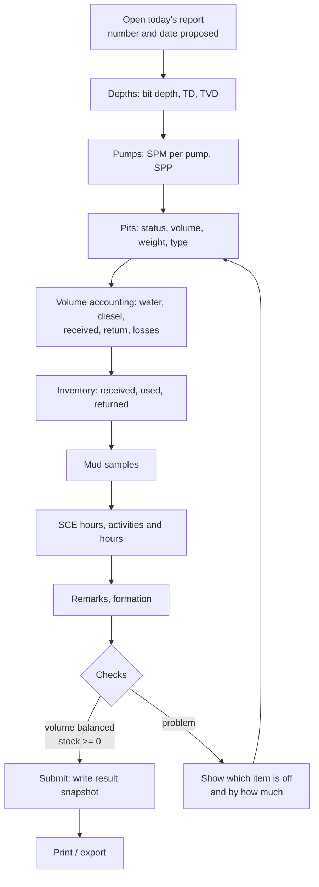

# DMR Workbook — Reverse-Engineering Specification

**Source file:** `DMR-SAVA-001_PYW-24ST1_RIG_GPTK-G2_2026.07.28.xlsm`
**What it is:** a macro-enabled Excel workbook that produces the *Daily Drilling Fluids (Mud) Report* (DMR) for one well, plus chemical inventory, volume accounting, solids analysis, hydraulics / hole cleaning, and an end-of-section recap.
**Purpose of this document:** describe every part of the workbook precisely enough to rebuild it as an online application.

How to read this document:

- Cell references are written `Sheet!A1`. A reference without a sheet name is on the `DMR` sheet.
- "Input" means an unlocked cell the user types into. "Calc" means a formula. "State" means a value that a macro pasted and that survives to the next day.
- Statements marked **(inferred)** come from the structure of the file, not from something written in it. Everything else was read directly from the formulas, the VBA source, or the sheet XML.
- Section 12 lists defects found in the file. Read it before you copy any formula.

---

## 1. The workbook in one page

| Fact | Value |
|---|---|
| Sheets | 28, all "visible" in the file, but the **sheet tab bar is turned off** and the workbook structure is locked. The only way to move between sheets is through buttons and keyboard shortcuts that run macros. |
| Protection | 27 of 28 sheets are protected (only `PLoss` is not). Inputs are the unlocked cells. The VBA project is password-locked. |
| Formulas | About 56,500. Two sheets account for 33,000 of them and do purely mechanical work (`Incl`: 19,475; `Chem Inv.`: 13,704). |
| VBA | Project name `DMRSoori`, 25 standard modules, 36 procedures, almost all recorded macros (`Select` / `Copy` / `PasteSpecial`). No event handlers with code, no user forms, no user-defined functions. |
| Age | Created 2005; macros recorded 2005–2008 and later; internal version cell `GData!I17` = 3.03. |
| Date system | **1904 date system** (`date1904="1"`). A raw serial number from this file is 1,462 days off from a normal Excel file. |
| Calculation | **"Precision as displayed" is ON** (`fullPrecision="0"`). Excel permanently rounds every value to its cell number format. Results in the file are therefore rounded at each step. |
| External links | Two dead links to old `.xls` copies on another computer. Some labels on `Hyd Calc.` still read from them (cached values). |
| Charts | 4: pressure loss by segment (bar), pressure loss % (bar), volume accounting (bar), cost share per product (3-D pie). |
| History | **None.** The workbook holds *today's* report and a set of running totals. Yesterday's data is overwritten by the "New Report" macro. History only exists as one saved file per day **(inferred** from the file name pattern `…_2026.07.28` and the absence of any log sheet). |

The single most important design fact: **the workbook is a one-day form with accumulators.** Everything that looks like a database operation (new day, new month, new section, new well) is a macro that copies a block of "current" cells onto a block of "previous" cells and then clears the inputs.

---

## 2. Who uses it and why

| Role | What they do with the workbook | Evidence |
|---|---|---|
| **Fluids (mud) engineer at the rig** — the main user; two names are printed on the report | Fills in the day's data, presses *New Report* each morning, prints or exports the DMR and inventory | `A83:A84` "FLUIDS ENGR", date arrived, days on location |
| **Operator representative** (here "KKC Rep.") | Receives and signs the printed DMR | `H7`, label built from the operator name |
| **Drilling contractor representative** (here "GPTK Rep.") | Receives the printed DMR | `H8` |
| **Fluids company office / coordinator** **(inferred)** | Receives the daily file, the clean export copies, and the Recap at the end of a section or well; follows cost | `DMR(2)`, `Chem Inv. (2)`, `Recap`, `Cost Chart`, cost cells |
| **Warehouse / logistics** **(inferred)** | Follows stock and deliveries | `Chem Inv.`, warehouse phone `S83:S84` |

Why each output exists:

- **DMR page** — the contractual daily record of mud properties, volumes, products used, and cost.
- **Chemical inventory** — stock control and the daily / section / monthly / cumulative cost.
- **Volume accounting** — proves where every barrel went (built, received, lost) and that the books balance.
- **Solids analysis** — tells the engineer how much low-gravity and high-gravity solid is in the mud (dilution and centrifuge decisions).
- **Hydraulics and hole cleaning** — checks pressure losses, ECD against formation limits, and whether cuttings are being carried out.
- **Recap** — the end-of-section / end-of-well summary used for invoicing and post-well review.

---

## 3. Sheet catalogue

Layers: **M** master data, **I** daily input, **E** calculation engine, **O** output / report, **U** utility.

| # | Sheet | Layer | Purpose | Inputs | Size |
|---|---|---|---|---|---|
| 1 | `GData` | M | Project and well header; unit system | `D4:D12`, `I4:I11`, `D17`, onshore/offshore radio | 44 f |
| 2 | `PEquip` | M | Mud pumps (max 3) | `C7:H9` | 9 f |
| 3 | `SCE` | M | Solids-control equipment (max 10) | `C7:I16` | 0 f |
| 4 | `MudPits` | M | Pit names and capacities (max 20) | `C7:D26` | 13 f |
| 5 | `PList` | M | Product catalogue (max 65) | `C6:I70` | 8 f |
| 6 | `WBG` | M | Wellbore geometry: casing / liner / open-hole sections (max 10) | `C6:L15` | 64 f |
| 7 | `BHA` | M | Drill string components (max 10), bit, nozzles, downhole-tool pressure loss | `C7:F16`, `B22:H24`, `J24`, `G27` | 100 f |
| 8 | `Incl` | M | Directional survey (max 299 stations) → TVD | `B6:D304` | 19,475 f |
| 9 | `DMR` | I + E + O | The hub: daily inputs, the printable report (`A1:AQ85`), the state block, and most calculation engines in hidden rows and columns | see §5 | 7,257 f |
| 10 | `MudPits(2)` | I | Today's pit status, volume, weight, mud type; today's volume-accounting inputs | `J2:J3`, `E8:K27`, `O10:O13`, `O15:O24`, `N22` | 1,507 f |
| 11 | `Chem Inv.` | I + O | Today's received / used per product; stock and cost; printable inventory (`A1:W75`) | `G11:H75`, cost radio `Q7` | 13,704 f |
| 12 | `Solid Ana` | E | Water-based mud solids analysis | `C2:C6`, `F6`, weighted radio | 358 f |
| 13 | `Solid Ana OBM` | E | Oil-based mud solids analysis | `C2:C5`, `F6`, weighted radio | 754 f |
| 14 | `Salt` | E / O | Viewer for the brine property tables (NaCl / KCl / CaCl2) | radio | 280 f |
| 15 | `Hyd Calc.` | E / O | Hydraulic report: pressure loss per segment, flow regime, hole cleaning | `P7`, virtual/actual radio | 346 f |
| 16 | `PLoss` | O | Chart: pressure loss (psi) per segment | — | 278 f |
| 17 | `Percent` | O | Chart: pressure loss (%) per segment | — | 271 f |
| 18 | `Mud Losses` | O | Chart: volume accounting, section or well | radio | 164 f |
| 19 | `Recap` | O | Section / well recap: chemicals used, cost, concentration, volumes, hours | `L4` radio | 2,093 f |
| 20 | `Cost Chart` | O | Pie chart of cost share per product | — | 334 f |
| 21 | `WellLog` | O | One-day summary block ("Drilled Well Log") | — | 36 f |
| 22 | `MudP WBM` | O | Today's three mud samples laid out as table rows (water-based layout) | — | 265 f |
| 23 | `MudP OBM` | O | Same, oil-based layout | — | 82 f |
| 24 | `DMR(2)` | O | Formula mirror of the DMR page without buttons, for clean export | — | 817 f |
| 25 | `Chem Inv. (2)` | O | Formula mirror of the inventory page, for clean export | — | 1,086 f |
| 26 | `Res-BKUP` | U | Flat formula mirror of every user input (a "backup view") | — | 3,590 f |
| 27 | `Res-BKUP (2)` | U | Second layout of the same mirror | — | 3,587 f |
| 28 | `BKUP` | U | Paste target for a backup taken from another file; a macro restores from it | pasted values | 0 f |

`BKUP` currently contains values from a **different well** (dated 2012, other company names). It is leftover data, not part of this well.

### 3.1 How the sheets feed each other



Note the unusual direction for master data: the header labels on `WBG`, `BHA`, `PEquip`, `MudPits`, `PList` are formulas that read from `DMR`, while `DMR` reads the data rows back from those sheets. `DMR` owns the labels and the unit text; the small sheets own the values.

---

## 4. Operations and their order

The workbook has five lifecycle operations. Each is a button in the strip below the DMR page (row 92) that runs a macro.



Scope of each operation (what it wipes):

| Operation | Scope | Keeps |
|---|---|---|
| **New Report** | One day | Master data, pit readings, TD, running totals (after rolling them) |
| **New Month** | Monthly received / used per product | Everything else |
| **New Section** | Section totals: volumes, hours, product usage, plan specs, section size | Well totals, stock |
| **New Well** | Well header, geometry, BHA, survey, pits status, **stock and all totals** | Rig equipment, product list, units, operator / contractor |
| **New Project** | Everything, including rig equipment, product list, engineers | Nothing but the template |

Because *New Well* wipes stock, the opening stock of a well is typed as "Received" on report 1. This file shows exactly that: report 1, every product's stock equals its daily "Rec." value.

**Order when a section changes (inferred from the formulas):** press *New Report* first, then *New Section*, then start typing. *New Section* takes "last end volume" as the new section's start volume, and that value is only correct after *New Report* has rolled the day.

### 4.1 New Report — the daily roll-over

Button → `CtrlNewReport` → `RunNewReport`.



The check flag: `G87 = I87 + J87 + Y234`

- `G86` = (hole volume `V11` + active pits `V15` + reserve pits `Y15`) − end volume `R81`. Non-zero means the volume books do not balance → adds 1.
- `Y234` = 2 for every product whose final stock is negative.

Warnings can be overridden; nothing is blocked. The month-start check at the end runs even when the user answered No.

Cells cleared on `DMR` by *New Report*:

| Range | Meaning |
|---|---|
| `AH2`, `AK5` | Manual report-number and date overrides |
| `AJ7`, `AP7` | Bit depth, TVD (TD `AM7` is kept) |
| `AP10`, `AP12`, `AP14`, `AP16` | SPM pump 1–3, standpipe pressure |
| `AA13` | "Fluid not mud" volume in hole |
| `L19:Z44` (input cells only), `O47:P47`, `T47:U47`, `Y47:Z47`, `L48:Z51` | All three mud samples |
| `AL35:AO44` | Solids-control usage and hours |
| `AA46:AQ54`, `AA56:AQ63`, `AH64:AQ65` | Drilling remarks, fluids remarks, formation / lithology |
| `A62:K69` | Activities and hours |
| `F100:H102` | Daily operation hours |

Not cleared, so they carry over as yesterday's values for the engineer to edit: pit status / volume / weight / type (`MudPits(2)!E8:K27`), TD, representatives, engineers, plan specs, BHA, geometry.

Vertical wells copy columns `R:Y`; directional wells copy `R:X`. Column `Y` only holds check flags and licence remnants, so the difference has no business effect.

### 4.2 New Section

`NewSection` (confirmation, then):

1. `I232` (last end volume) → `L214` (section start volume).
2. `R201` (current report number) → `E208` ("DMR start of section").
3. `R202:R203` → `E206:E207` (depth at the end of the previous section).
4. Clear `N204:N206` (section operation hours), `L215:L232` (section volume totals), `I235:I299` (section product usage), `F73:H75` (plan specs), `AK3` (section size), `S102`.

### 4.3 New Month

`NewMonth` clears `J235:K299` — monthly received and monthly used for all products. Nothing else.

The automatic prompt depends on `HI229`, which compares the report date with a fixed table of month-start dates in `GO201:HI212` covering **January 2009 to December 2029**. After 2029 the prompt will silently stop appearing.

### 4.4 New Well

`CtrlNewWell` (confirmation, then, in this order):

1. `GData`: clear well name, designation, spud date, well type, water depth.
2. `DMR`: clear daily inputs; run `RunNewReport`.
3. `Chem Inv.`: clear `G11:H75`.
4. `DMR`: clear the whole state block `I201:O299`, mud-type row `L19:P19`, plan specs, section depth markers, section size, custom rows.
5. `MudPits(2)`: clear pit readings, mud type, volume inputs.
6. `WBG`: clear `C6:I15`. `BHA`: clear components, bit, nozzles, tool pressure loss. `Incl`: clear `B6:D304`.
7. `DMR`: clear operation hours.

Step 2 runs `RunNewReport` *before* step 4 wipes the state, so the roll-over it performs is thrown away. The net effect is a clean well.

### 4.5 New Project

`NewProject` does everything *New Well* does and also clears `PEquip!C7:H9`, `SCE!C7:I16`, `MudPits!C7:D26`, `GData!D4:E12` and `I4:J11` (all header fields **and the unit system**), `PList!C6:I70`, and on `DMR` the representatives, engineers, phone numbers, and the five "key product" selectors.

### 4.6 Other macros

| Macro | Trigger | What it does |
|---|---|---|
| `SortproductListAndconsumed` | Button on `PList`, confirmation | Sorts the product list A→Z **and** re-orders the carried stock and totals to match, using a scratch area at `AK235:BB299` and `AK1233:AZ1299`. Writes the sorted list back to `PList!C6`, the sorted totals to `I235`, and today's received / used to `Chem Inv.!G11`. |
| `Recap` | Button | Copies `AE201` (=1) into `M201` to switch the recap on, then opens `Recap`. |
| `Incl` | Button | Opens the survey sheet only if the well is directional; otherwise offers to go to `GData` and change the well type. |
| `SolidsAnaly` | Button | Opens `Solid Ana` if `AE375` = 1 (water-based or brine) or `Solid Ana OBM` if 2 (oil-based). |
| `BHABackToMenu` | "Back" on `BHA` | Refuses to leave while `BHA!O17` > 0, i.e. a motor or downhole tool is in the string and its pressure loss `J24` is empty. |
| `ExtractData` | Ctrl+Shift+Z | Copies the active sheet into a new workbook. |
| `DMR2`, `ChemInv2` | Ctrl+Shift+A, Ctrl+Shift+S | Copy `DMR(2)` / `Chem Inv. (2)` into a new workbook — the clean export. |
| `Macro1` | Ctrl+Shift+T | Restore from `BKUP`: survey → `Incl`, densities → solids sheets, header fields → `DMR`. The recording stops half-way; the last copy is never pasted. |
| `Macro2` | Ctrl+d | Copies `Z204:Z207` to `P204` (licence remnant). |
| 20 navigation macros | Buttons / shortcuts | `Sheets("X").Select : Range("A1").Select` and nothing more. |

Keyboard shortcuts replace standard Excel keys: **Ctrl+P, Ctrl+Z, Ctrl+Y, Ctrl+I, Ctrl+U, Ctrl+O, Ctrl+K, Ctrl+D, Ctrl+G** all run navigation macros in this workbook. Print, undo and redo by keyboard do not work.

---

## 5. The `DMR` sheet in detail

### 5.1 Physical layout

| Area | Content |
|---|---|
| `A1:AQ85` | The printable report page |
| Rows 86–97, `A:AQ` | Control strip: buttons, balance check, hole-cleaning inputs, custom activity names |
| Rows 98–102 | Daily operation hours (rows hidden in the saved file) |
| Rows 189–1501 | Hidden: state block, product table, calculation engines |
| Columns `AS` onward (to `JU`) | Hidden: lookup copies of master data, unit factors, dropdown lists, geometry engine |

### 5.2 Report page, block by block

| Block | Range | Content | Source |
|---|---|---|---|
| Header | `G4:V8`, `AG2:AQ8` | Operator, well, contractor, field, designation, rig, representatives, report number, section size, mud type, date, spud date, depths, well status, present activity | `GData`, inputs, calc |
| Drilling assembly | `A10:A17` | One text line per string component, bit and nozzles | `BHA` |
| Well profile | `L10:L17` | One text line per hole section | `WBG` |
| Mud volume | `V10:AB17` | Hole, string, annulus, below bit, active, reserve, total circulating, daily drilled length and volume | calc |
| Pump information | `AE10:AP17` | Per pump: model, liner × stroke, efficiency, SPM (input), gal/stroke; flow rate; SPP (input); bottoms-up; total circulation time | `PEquip`, inputs, calc |
| Mud properties | `A18:Z51` | Three sample columns (`L:P`, `Q:U`, `V:Z`), about 30 property rows | inputs + calc |
| Products used last 24 h | `AA19:AO32` | Up to 13 products with used > 0: name, package, used, final stock, cost | `Chem Inv.` |
| Solids-control equipment | `AA34:AP44` | Up to 10 units: type, screen / model, usage, hours today (input), cumulative hours | `SCE`, input, state |
| Drilling remarks | `AA46:AQ54` | Free text | input |
| Surface volume | `A53:Z60` | Up to 14 pits holding fluid: name, status, weight, volume, mud type | `MudPits(2)` |
| Fluids remarks | `AA56:AQ63` | Free text | input |
| Activities | `A62:K69` | Up to 8 activities (dropdown) with hours; total | input |
| Formation | `AH64:AQ65` | Free text | input |
| Volume accounting | `L61:Z81` | 19 items × daily / section / well | `MudPits(2)`, state |
| Solids analysis | `AA66:AF75` | Result lines | solids sheets |
| Rheology and hydraulics | `AI66:AO75` | n and K, bit pressure loss, HHP / HSI, impact force, velocities, ECD | engine |
| Hole cleaning | `AA76:AO81` | Four annular sections × five indicators | engine |
| Plan vs actual | `A71:I75` | Planned weight / yield point / fluid loss (input) against the latest sample | input + calc |
| Key stock | `A76:I81` | Five product numbers chosen by the user → name, stock, unit | input + lookup |
| Footer | `A82:AN84` | Engineers, date arrived, days, phones, stock value, daily / monthly / cumulative cost | input + `Chem Inv.` |

### 5.3 Header logic worth copying exactly

| Cell | Rule |
|---|---|
| Report number `AG2` | `IF(AH2>0, 0, I201+1)` → previous report number + 1, unless a manual number is typed in `AH2`. The displayed number is `AG2 + AH2`. |
| Date `AJ5` | Spud date + report number − 1 + a remembered offset (`M202`). If a date is typed in `AK5` it wins. Consumers always use `AJ5 + AK5`. |
| Well status `V8` | Type and OD of the last defined hole section, e.g. `Casing 9.625"`. |
| Present activity `AJ8` | The last filled row of the activity list `A62:A69`. |
| Daily drilled `V17` | `AM7 − I202` → TD today − TD of the previous report. |
| Drilled volume `AA17` | π/4 × (hole diameter × 0.0254)² × drilled metres × 6.29. |
| Actual values `I73:I75` | "Latest sample wins": sample 3 if filled, else sample 2, else sample 1. The same rule feeds hydraulics. |

### 5.4 Mud type switches the form

`MudPits(2)!J2` is one of `WBM`, `OBM`, `Brine`. It sets `AE375` = 1 (WBM or Brine) or 2 (OBM). That flag changes the row labels and units of the mud-properties table:

| Row | `AE375` = 1 | `AE375` = 2 |
|---|---|---|
| 32 | API Fluid Loss | HTHP Fluid Loss |
| 33 | HTHP Fluid Loss / Press | HTHP Temp / Press |
| 39 | pH / Temp | Electrical Stability (Volt) |
| 40 | Alkal Mud (Pm) | Alkalinity (Pom) |
| 41 | Pf / Mf | — |
| 43 | NaCl | CaCl2 |
| 45 | PV / YP (metric) | NaCl |
| 46 | Gels (metric) | Oil : Water Ratio |
| 47 | KCl | Lime Content |
| 48 | Glycol | — |

It also selects which solids sheet is used. In the online version this is a *report template per mud system*, not a set of string switches.

Checkboxes on the page: `G43` (linked `D248`) "report NaCl", `G47` (linked `D249`) "report KCl". Checkbox below the page (linked `AE210`) "Show operation hours in Recap".

### 5.5 The state block — the workbook's "database"

Rows 201–299. Columns `R:Y` are **live** formulas (today). Columns `I:P` are **stored** values (as of the previous report). *New Report* copies `R:Y` onto `I:P`.

| Rows | Live `R:Y` | Stored `I:P` | Used by |
|---|---|---|---|
| 201 | `R201` report number | `I201` last report number | Next report number |
| 202 | `R202` TD | `I202` last TD | Daily drilled |
| 203–212 | `R` cumulative hours of each solids-control unit | `I203:I212` | Cum hours = today + stored |
| 204–206 | `V` daily, `W` section, `X` well operation hours (drilling, circulation, tripping) | `M`, `N`, `O` | Hours totals |
| 202, 208–209 | Dates and date offset | `M202`, `M208`, `M209` | Date continuity |
| 214–232 | Volume accounting, 19 items: `R` daily, `U` section, `X` well | `I`, `L`, `O` | Start volume = `I232`; section and well totals |
| 235–299 | Per product (65 rows): `R` section used, `S` monthly received, `T` monthly used, `U` cumulative received, `V` cumulative used, `W` returned, `X` final stock | `I` … `O` | Opening stock and all totals on `Chem Inv.` |

Beside it, `Z235:AH299` is a live copy of the product list (`PList`) with today's received / used, and `AK235:BB299` is the sort macro's scratch area.

**Products are identified by row position, not by an ID.** Row *n* of `PList`, row *n* of `Chem Inv.`, and row *n* of the state block are assumed to be the same product. Inserting or re-ordering a product without the sort macro silently attaches stock to the wrong product.

### 5.6 Dropdown lists (stored in hidden columns)

| List | Range | Values |
|---|---|---|
| Sample from | `FB9:FB29` | 21 entries, 18 distinct: Active, Reserve, Flow Line, Recd Mud, Return Mud, Treated Fluids, Brine, Bottom's Up, Drill water, Canal Water, Recd Water, Sea Water, Potable Water, Waste Pit, Cleared Water, Completion Fluid, Brackish Water, Other |
| Activity | `FV8:FV68` | 58 fixed activities (Back Reaming … Waiting on Tools) + 3 custom names from `A89:A91`. Two fixed names occur twice ("Run Completion", "Work Direction") and some carry trailing spaces, so 56 are distinct. Full list: `apps/api/src/db/seed/lookups-data.ts` |
| Section type | `FF9:FF12` | Conductor, Casing, Liner, Open Hole |
| Bit type | `FS8:FS14` | core - diamond, core - PDC, diamond - fixed cut, insert - roller cone, mill tooth, PDC - fixed cutter, Other |
| Pit type | inline | Active, Reserve, Not Mud |
| Fluid type | inline | WBM, OBM, Brine |
| Active fluid system | `MudPits(2)!T41:T55` | 15 systems (Drill Water, Bentonite Mud, Salt Mud, Salt Saturate Mud, KCl/Salt Mud, Inhibited Mud, HPHT Mud, Low Weight Mud, NaCl Brine, CaBr2 Brine, CaCl2 Brine, CaCl2 / NaCl, Oil Base Mud, Invert Emulsion Mud, Fresh Water) |
| Pit mud type | `MudPits(2)!V41:V69` | 29 names: 13 of the systems above (Drill Water … Oil Base Mud), 15 pills and special fluids (PHG PILL, HI VIS PILL, LCM PILL, Low Vis Pill, KILL MUD, SLUG PILL, High pH PILL, PIPE LAX PILL, KCl PILL, Inhibition PILL, Detergent PILL, Solution, CMT Solution, LPM PILL, Contingency PILL), then Invert Emulsion Mud. "Fresh Water" is not in this list |
| Product unit | inline | kg, Lb, MT, Gal, Lit, m3, bbl |
| Product origin | inline | F (foreign), L (local) |
| Well designation | inline | Development, Gas Injection, Key Well, Appraisal, Water Injection, Water Disposal, Exploration, Cuttings Re-Injection, Workover, Repairing, Re-Entry, New Leg, Perforation, Plugging |
| Currency | inline | $, £, ¥, €, ¢, kn, IRR |
| SCE type / maker, bit maker, pump type | inline | see `SCE`, `BHA`, `PEquip` validations |

---

## 6. Master-data sheets

### 6.1 `GData` — general data and units

| Field | Cell | Notes |
|---|---|---|
| Operator, well name, contractor, field / country, well designation, rig name | `D4:D9` | Text |
| Spud date (label switchable to "Pre-Spud Date") | `D10`, label `B10` | Base of the automatic report date |
| Currency | `D11` | Printed in every cost label |
| Well type | `D12` | Vertical / Directional → `F12` = 1 / 2 |
| Rig type | radio → `K1800` | Onshore / Offshore; offshore shows a water-depth field `D17` |

Unit system (`I4:I11`), with the conversion factor cells on `DMR`:

| Quantity | Options | Factor cell | Factor |
|---|---|---|---|
| Volume | bbl, m3 | `BN92` | 6.29 bbl per m³, or 1 |
| Mud weight | S.G., PPG, PCF | `BO93` | 1, 8.344, 62.4 |
| Temperature | °F, °C | — | label only |
| Pressure | kg/cm2, bar, psi | `BO95` | 14.22, 14.5, 1 |
| Flow rate | m3/min, Lit/min, Gal/min | `BO96` | 0.001, 1, 0.264172 |
| Concentration | lb/bbl, kg/m3 | `BO94` | 1, 2.85 |
| Length | m, ft | `BO97` | 1, 3.28084 |
| Funnel viscosity | sec/qt, sec/lit | — | label only |

Every engine converts to oilfield units (ppg, gpm, ft, psi, inches), calculates, and converts back for display. Diameters are always inches.

### 6.2 `PEquip` — pumps (3 rows)

Model, stroke length (in), efficiency (%), liner diameter (in), type (Duplex / Triplex).

Output per stroke (`BP37:BP39`):

```
gal/stroke = π/4 × (liner_in × 0.0254)² × (stroke_in × 0.0254) × N × eff% × 10 × 0.264172
N = 3 for Triplex, 2 for Duplex
```

Check: 6 in × 12 in, 95 % → 4.19 gal/stroke, as shown in the file.

### 6.3 `SCE` — solids-control equipment (10 rows)

Type, unit number, manufacturer, screen size, model. The DMR prints `maker type #n`; the engineer types usage and hours per day; cumulative hours come from the state block.

### 6.4 `MudPits` — pit definitions (20 rows)

Pit name and capacity. `MudPits(2)` reads them and adds the daily reading.

### 6.5 `PList` — product catalogue (65 rows; 28 used in this file)

Product name, package size, unit, specific gravity, origin (F / L), unit price. An empty name is replaced by `zzzzz` so that unused rows sort to the bottom.

### 6.6 `WBG` — wellbore geometry (10 rows)

Per section: type, top MD, bottom MD, OD, ID (or bit diameter for open hole), linear weight, grade, and a planning triple (section size, casing size, section TD).

Engine (`DMR!CE5:DF30`):

```
section volume (m³) = π/4 × (ID_in × 0.0254)² × (bottom − top)
```

- Computed twice: down to **bit depth** (`CI5:CP14`) and down to **TD** (`CI20:CP29`).
- A liner overlapping the previous casing only counts below the overlap.
- `WBG!M18` = volume-weighted average hole ID.

### 6.7 `BHA` — drill string (10 rows) and bit

- Row 7 is drill pipe. Its length is **not typed**: `BK20 = bit depth − Σ(other components)`.
- Per component: steel volume = π/4 (OD² − ID²) L, internal volume = π/4 ID² L, closed displacement = sum of both.
- Bit: type, size, manufacturer, up to 3 nozzle groups (size in 32nds × quantity). TFA = π/4 Σ (d/32)² × qty, or a known TFA typed in `G27`.
- `J24`: pressure loss of motor / downhole tools (psi), required when such a tool is present. The sheet recognises tools by matching the typed name against a list of 26 spellings (`B32:B57`: "Bit", "Motor", "Mud Motor", "DHT", "Down Hole tools", …).
- Hydraulics and hole cleaning need **at least 3 components**.

### 6.8 `Incl` — directional survey (299 stations)

Inputs: MD, inclination, azimuth. Output: TVD.

Each interval is cut into 30 slices, inclination interpolated linearly:

```
TVD_i = TVD_(i−1) + Σ (k = 1..30)  (ΔMD/30) × cos(ΔAzi/30) × cos( Inc_(i−1) ± k × |ΔInc|/30 )
```

This needs 9,000 helper cells per pass and explains the sheet's 19,475 formulas. The `cos(ΔAzi/30)` factor is part of the file's method; it is not the standard minimum-curvature formula. Other sheets read TVD and inclination at a depth with an approximate-match `VLOOKUP` (nearest station at or above the depth, no interpolation).

---

## 7. Daily-input sheets

### 7.1 `MudPits(2)` — pit readings and volume inputs

Header: fluid type `J2` and active system `J3`.

Per pit (20 rows): pit type, volume, mud weight, mud type.

Validation rules:

- Volume between 0 and the pit capacity. Error text: "Wrong data you are entering volume more than pit capacity…".
- Mud weight between `AE2` and `AE3` = 0.5 and 2.6 times the weight of water in the chosen unit.

Derived:

- Tonnage per pit = MW / water weight × volume / 6.29 (metric tons).
- Totals per type: Active `U23`, Reserve `U24`, Not Mud `U25`.
- Pits holding fluid are packed upwards into `BQ8:BX31` and printed on the DMR (14 rows).

Volume accounting inputs (`O10:O24`) — see §8.2.

### 7.2 `Chem Inv.` — chemical inventory

Inputs: `G` received, `H` used (65 rows). A **negative "received" means a return** to the warehouse.

| Column | Meaning | Formula (row *n*) |
|---|---|---|
| `F` | Initial stock | previous final stock (`W` ← `DMR!O`) |
| `I` | Section used | stored section used + `H` |
| `J` | Monthly received | stored + `G` if `G` > 0 |
| `K` | Monthly used | stored + `H` |
| `L` | Cumulative received | stored + `G` if `G` > 0 |
| `M` | Cumulative used | stored + `H` |
| `N` | Returned | stored − `G` if `G` < 0 |
| `O` | **Final stock** | `F + G − H` |
| `P` | Daily cost | `H × price` |
| `Q:W` | Stored totals | `DMR!I235:O299` |

Cost cells: daily `N4` = Σ(H × price); section `N5` = Σ(I × price); monthly `N6` = Σ(K × price); cumulative `N7` = Σ(M × price). With the radio "Show Local Cost" (`Q7` = 1) a second column repeats each cost for products of origin `L` only. Stock value (`DMR!AB83`) = Σ(final stock × price).

Volume of chemicals added to the mud (`AB:AI`, m³ per product, from **used**):

| Unit | Volume (m³) |
|---|---|
| kg | size / SG × used / 1000 |
| lb | size / SG × used / 2204 |
| MT | size / SG × used |
| Gal | size × used × 3.785 / 1000 |
| lit | size × used / 1000 |
| m3 | size × used |
| bbl | size × used / 6.29 |

`AH76` is the total and becomes the "Chemical Vol." line of the volume accounting.

Rows 101–165 and columns `X:GJ` are a formula-only **row compactor**: about 9,750 cells that push the products with usage > 0 to the top, to feed "Products used last 24 h" on the DMR and the Recap table. In a database this is `WHERE used > 0`.

---

## 8. Calculation engines

### 8.1 Hole and string volumes (`DMR!BV17:BV26` → page `V11:AB17`)

| Output | Formula |
|---|---|
| Hole `V11` | total hole volume − string steel volume − "fluid not mud" (`AA13`) |
| String `Y11` | internal volume of the string |
| Annulus `AB11` | hole volume at bit depth − closed displacement of the string |
| Below bit `V13` | total hole volume − hole volume at bit depth |
| Active `V15`, Reserve `Y15` | pit totals |
| Total circulating volume `AB15` | Active + Hole − Below bit |
| Flow rate `AH16` | Σ (gal/stroke × SPM) |
| Bottoms-up `AG17` | annulus volume ÷ flow → minutes / strokes |
| Total circulation time `AO17` | total circulating volume ÷ flow |

### 8.2 Volume accounting

Inputs are on `MudPits(2)`, the table prints on `DMR!L61:Z81`.



Loss items: Dumped, Shakers, Evaporation, Super Clone (centrifuge), Trip Loss, Desander & Desilter, Pit Cleaning, Other (label editable in `N22`), Formation, Left in Hole.

Section and well columns: `stored total + today`. Two exceptions in the section / well columns: Total Losses is recomputed as `Start + Received − Return + Built − End volume`, and **Shakers is the balancing item** (`Total Losses − Dumped − all other losses`).

`Mud Losses` charts the section or well column. `Recap` groups Dumped → Pit Cleaning + Other as *surface losses* and Formation + Left in Hole as *sub-surface losses*.

### 8.3 Rheology

From the latest sample's dial readings (`DMR!E302:J305`):

```
PV = R600 − R300            YP = R300 − PV
np = 3.32 × log10(R600 / R300)        Kp = 5.11 × R300 / 511^np      (inside pipe)
na = 0.657 × log10(R100 / R3)         Ka = 5.11 × R100 / 170.2^na    (annulus)
```

### 8.4 Salt and solids analysis

Brine density from chlorides (mg/L):

```
SG_brine = 1 + 1.166e-6 × Cl − 8.375e-13 × Cl² + 1.338e-18 × Cl³
NaCl %wt = Cl × 1.65 / (SG_brine × 10000)
```

File check: Cl = 188,000 → SG 1.198, NaCl 25.9 %wt, 108.5 lb/bbl.

`Solid Ana` also carries NaCl and KCl property tables (rows 41–67: weight %, density, Cl⁻, cation, lb/bbl, water fraction, crystallisation point, water activity) and interpolates linearly between whole-percent rows. `Salt` is only a viewer of these tables.

Solids (weighted mud), densities in ppg, volumes in %:

```
HGS% = [ 100×MW − (100 − Water − Vsalt − Oil)×ρLGS − (Water + Vsalt)×ρbrine − Oil×ρoil ] / (ρHGS − ρLGS)
LGS% = 100 − Water − Vsalt − Oil − HGS%
```

Unweighted mud: `LGS% = (MW − ρbrine) / (ρLGS − ρbrine) × 100`.
Mass concentration: `lb/bbl = % / 100 × ρ(ppg) × 42`.
Bentonite: `(MBT − f × LGS) / (1 − f)`, with `f` the bentonite fraction of drill solids.

Parameters on the sheet: oil, glycol, LGS and HGS density, bentonite fraction, drill-solids SG (`F6`, default 2.5; also used by hole cleaning), weighted / unweighted radio.

`Solid Ana OBM` does the same for oil muds and adds CaCl2 %wt / ppm, water-phase salinity, water activity, lime content (`Pom × 1.295`) and oil : water ratio.

Results are joined into text ("25.9/ 108.5") and printed in `DMR!AA67:AF75`.

### 8.5 Hydraulics

Power-law model, oilfield units (Q gpm, D in, ρ ppg, V ft/min, L ft, ΔP psi). Computed per string component (`DMR` rows 411–420) and per annular section (rows 429–432).

| Step | Pipe | Annulus |
|---|---|---|
| Velocity | `24.48 Q / ID²` | `24.48 Q / (Dh² − Dp²)` |
| Effective viscosity (cP) | `100 Kp (1.6 V / ID)^(np−1) ((3np+1)/(4np))^np` | `100 Ka (2.4 V / (Dh−Dp))^(na−1) ((2na+1)/(3na))^na` |
| Reynolds number | `15.467 V ID ρ / μ` | `15.467 V (Dh−Dp) ρ / μ` |
| Friction factor, Re < 2100 | `16 / Re` | `24 / Re` |
| Friction factor, Re ≥ 2100 | `((log n + 3.93)/50) / Re^((1.75 − log n)/7)` | same with `na` |
| Pressure loss | `f V² ρ / (92916 ID) × L` | `f V² ρ / (92916 (Dh−Dp)) × L` |

Bit and system:

| Quantity | Formula |
|---|---|
| Bit pressure loss, roller-cone | `156 ρ Q² / (Σ dn²)²`, dn in 32nds |
| Bit pressure loss, PDC / diamond fixed cutter | `ρ Q² / (10858 TFA²)` |
| Bit hydraulic horsepower | `Q × ΔPbit / 1740` |
| HSI | `1.27 × HHP / bit_size²` |
| System horsepower | `ΔPtotal × Q / 1714` |
| Jet velocity | `417.2 Q / Σ dn²` |
| Impact force | `Vjet × Q × ρ / 1930` |
| ECD | `MW + ΔPannulus / (0.052 × TVD)` at shoe and at TD |

Flow regime label on `Hyd Calc.`: Laminar < 2100, Transient 2100–4100, Turbulent > 4100.

Two modes (radio on `Hyd Calc.`, `AQ18`):

- **Virtual** — pure calculation.
- **Actual** — pipe and annulus losses are scaled so that the total equals the measured standpipe pressure: `factor = (SPP − ΔPbit − ΔPtools) / (ΔPpipe + ΔPannulus)`.

`Hyd Calc.!P7` is a manual pressure-loss coefficient applied to the string.



### 8.6 Hole cleaning

Inputs below the page: particle thickness `AP90`, particle diameter `AP91` (inches), ROP `AP92`. Drill-solids SG from the solids sheet.

For each of the four annular sections the engine computes:

For each of the four annular sections (blocks at `DMR` rows 442–455, 458–471, 474–487, 490–503), with cutting diameter `dc`, cutting thickness `T`, mud weight `ρ` (ppg) and cutting density `ρp` = drill-solids SG × 8.33:

| Step | Formula |
|---|---|
| Boundary shear rate | `γb = 186 / (dc × √ρ)` |
| Particle shear stress | `τp = 7.9 × √( T × (ρp − ρ) )` |
| Particle shear rate | `γp = (τp / Ka)^(1/na)` |
| Slip velocity, laminar annulus (Re ≤ 2100) and γp < γb | `Vs = 1.22 × τp × ( γp × dc / √ρ )^0.5` |
| Slip velocity, turbulent annulus (Re > 2100) | `Vs = 16.62 × τp / √ρ` |
| Transport velocity | `Vt = Va − Vs` |
| Transport efficiency | `Et = Vt / Va` |
| Cutting concentration (fraction) | `Ca = ROP × Dh² / (14.71 × Et% × Q)`, ROP in ft/hr |
| Angle factor | Lookup on hole inclination: 1.00 at 0°, minus 0.04 per 5°, 0.50 at 65° and above (`AO441:AP454`) |
| Transport ratio (printed) | `Et × angle factor` |
| Hole-cleaning index | `Et × angle factor × (0.1 − Ca / 1.5) × 10` |
| Verdict | index > 0.75 V-Good, > 0.5 Good, > 0.25 OK, otherwise Poor; `Ca` > 0.05 forces "V-Poor" |

A second slip-velocity expression, `175 × d × (ρp − ρf)^0.667 / (ρf × μ)^0.333`, feeds the "Jet / Slip velocity" line of the report.

Printed in `DMR!AA77:AO81` and on `Hyd Calc.` rows 21–24.

---

## 9. Output sheets

| Sheet | What it shows | Controls |
|---|---|---|
| `DMR` page | §5.2 | — |
| `Chem Inv.` | Full inventory with cost block | Radio: show / hide local cost |
| `Recap` | Header, cost, chemicals consumption table (row, product, unit size, price, used, cost, concentration, cost %), volume accounting with loss items, operation hours, average ROP. 48 products on page 1, overflow on page 2. | `M201` = 1 switches it on (set by the macro); radio `L4`: 1 = section, 2 = well |
| `Cost Chart` | Pie of cost % per product | Opened from `Recap` |
| `Mud Losses` | Bar chart of the 19 accounting items | Radio: section / well |
| `Hyd Calc.` | Hydraulic report table | Radio: virtual / actual |
| `PLoss`, `Percent` | Bar charts of pressure loss per segment | — |
| `WellLog` | 14-line summary of the day | — |
| `MudP WBM`, `MudP OBM` | Three samples as table rows, ready to paste into an external log | — |
| `DMR(2)`, `Chem Inv. (2)` | Button-free mirrors for export | — |

Concentration in the Recap = mass (or volume) of product used ÷ volume of mud built in the section or well, in lb/bbl or kg/m³ (liquids: % by volume).

---

## 10. Validation and feedback rules

| Rule | Where | Behaviour |
|---|---|---|
| Volume books must balance | `G86`, `MudPits(2)!V17` | Shows "Balanced" or the difference; warning at New Report |
| Final stock must not be negative | `Chem Inv.!O11:O75`, `Y235:Y294` | Highlight; warning at New Report |
| Pit volume ≤ capacity | `MudPits(2)!F8:G27` | Entry rejected |
| Mud weight within 0.5–2.6 × water | `MudPits(2)!H8:I27` | Entry rejected |
| Survey MD must increase | `Incl!B6:B304` | Highlight |
| ID not required for bit / motor rows; OD not required for the bit row | `BHA!E8:F16` | Entry rejected with explanation |
| Tool pressure loss required when a motor / DHT is in the string | `BHA!O17`, macro | Cannot leave the sheet |
| Directional well: survey must be updated | macro | Question before New Report |
| Empty mandatory text (representatives, date arrived, formation) | `H7:H8`, `G83:J84`, `AH64:AQ65` | Yellow fill |
| Zero / empty results ("0/0", "0/", "0/0/0") | most output cells | Hidden by conditional formatting |
| Activity hours | `J70` | Total shown; 24 h is not enforced |

---

## 11. Capacity limits built into the layout

| Item | Limit |
|---|---|
| Hole sections | 10 |
| String components | 10 (drill pipe + 9) |
| Nozzle groups | 3 |
| Pumps | 3 |
| Solids-control units | 10 |
| Pits | 20 defined, 14 printed |
| Products | 65 (negative-stock check and stock lookup cover only the first 60) |
| Products printed on the DMR per day | 13 |
| Mud samples per day | 3 |
| Activities per day | 8 |
| Custom activity names | 3 |
| Survey stations | 299 |
| Key-stock products on the DMR | 5 |
| Custom mud-property rows | 3 (`A49:A51`) |

---

## 12. Defects and risks found in the file

1. **Dates are stored as text.** `GData!D10` (spud date) and `AK5` hold the string `28/07/2026`. Every date calculation returns `#VALUE!`: automatic date `AJ5`, days on location `K83:K84`, date on `WellLog` and `MudP` sheets, date on `MudPits(2)!O3`, the month-start flag `HI229`. Two cell comments contradict each other on the expected format (`dd/mm/yy` on `GData`, `mm/dd/yy` on `DMR`). `CtrlNewReport` compares `HI229` with 1 after the roll-over; with an error value in that cell VBA is likely to stop with a type-mismatch error, and the New Month prompt never appears.
2. **Typo in the annulus pressure-loss formula** `L349`: it multiplies by `X3609` (an empty cell) where `X360` is meant, so the drill-pipe annulus term is always zero in that block. The parallel calculation in rows 429–433 is the one that feeds the report.
3. **Wrong cells in `MudP WBM` / `MudP OBM`**: columns are gated by `DMR!G60 = "WBM"` and `DMR!S59 = "OBM"`, which are not mud-type cells. Fluid loss, salts, pH, glycol, ES and Pom columns therefore always show 0.
4. **10th solids-control unit never accumulates hours**: `R212` reads `AP47` instead of `AP44`.
5. **Unanchored lookup** in `B81`: `VLOOKUP(A81, BI105:BP164, 2)` while rows 77–80 use `$BI$101:$BP$160`. The fifth key product can show the wrong name.
6. **Two horsepower constants**: bit HHP divides by 1740, system HHP by 1714. The usual constant is 1714.
7. **Mixed water-density constants**: 8.33, 8.34, 8.344 and 8.345 ppg are all used, and 62.4 PCF on `DMR` against 62.35 PCF on `MudPits(2)`. Results differ in the third digit between blocks.
8. **Solids analysis runs on empty retort data** and produces nonsense internally (this file: HGS −15 %, LGS 115 %); only the output gate hides it.
9. **Row-position identity of products** (§5.5).
10. **Dead external links**; `Hyd Calc.` column headers depend on cached values from them.
11. **`DMR(2)` activity dropdown** points to `#REF!`.
12. **Month-start table ends in 2029.**
13. **Keyboard shortcuts override Print, Undo, Redo** and others.
14. **No undo for macros.** New Report, New Section, New Well and New Project destroy data immediately; the only protection is a Yes / No box.
15. **Legacy licence mechanism.** A "season password", a "monthly password", a quarter-by-quarter table of validity dates for 2011–2017, and checksums built from `CODE()` of header text and product names (`GA19:HR89`). All enforcement is commented out in the VBA. The cells remain and mostly evaluate to `#VALUE!`. Do not migrate.
16. **"Precision as displayed" and the 1904 date system** change numbers and dates when data is copied to another workbook or read by a script.
17. **`Macro1` (restore from backup) is incomplete**, and `BKUP` holds another well's data.

---

## 13. Proposed data model for the online version

The model replaces the state block with stored rows and replaces every "total" with a query.

```mermaid
erDiagram
  PROJECT ||--o{ WELL : has
  PROJECT ||--o{ PUMP : owns
  PROJECT ||--o{ SCE_UNIT : owns
  PROJECT ||--o{ PIT : owns
  PROJECT ||--o{ PROJECT_PRODUCT : prices
  PRODUCT ||--o{ PROJECT_PRODUCT : listed_as
  WELL ||--o{ HOLE_SECTION : geometry
  WELL ||--o{ SURVEY_STATION : survey
  WELL ||--o{ DRILLING_SECTION : phases
  WELL ||--o{ DAILY_REPORT : reports
  DRILLING_SECTION ||--o{ DAILY_REPORT : contains
  DRILLING_SECTION ||--o{ BHA_RUN : uses
  BHA_RUN ||--o{ BHA_COMPONENT : made_of
  BHA_RUN ||--o{ BIT_NOZZLE : has
  DAILY_REPORT }o--|| BHA_RUN : in_hole
  DAILY_REPORT ||--o{ MUD_SAMPLE : has
  DAILY_REPORT ||--o{ PIT_READING : has
  DAILY_REPORT ||--o{ VOLUME_ENTRY : has
  DAILY_REPORT ||--o{ INVENTORY_MOVE : has
  DAILY_REPORT ||--o{ PUMP_READING : has
  DAILY_REPORT ||--o{ SCE_USAGE : has
  DAILY_REPORT ||--o{ ACTIVITY : has
  DAILY_REPORT ||--|| REPORT_RESULT : snapshot
  PIT ||--o{ PIT_READING : measured
  PROJECT_PRODUCT ||--o{ INVENTORY_MOVE : moved
  PUMP ||--o{ PUMP_READING : ran
  SCE_UNIT ||--o{ SCE_USAGE : ran

  PROJECT {
    uuid id PK
    string operator
    string contractor
    string rig_name
    string field_country
    string currency
    json unit_system
  }
  WELL {
    uuid id PK
    uuid project_id FK
    string name
    string designation
    string well_type
    date spud_date
    string rig_type
    numeric water_depth
  }
  DRILLING_SECTION {
    uuid id PK
    uuid well_id FK
    numeric hole_size_in
    string fluid_type
    string fluid_system
    numeric plan_mw
    numeric plan_yp
    numeric plan_fluid_loss
  }
  DAILY_REPORT {
    uuid id PK
    uuid well_id FK
    uuid section_id FK
    int report_no
    date report_date
    numeric bit_depth
    numeric td
    numeric tvd
    numeric spp
    numeric fluid_not_mud_vol
    numeric rop
    text drilling_remarks
    text fluid_remarks
    text formation
    string status
  }
  MUD_SAMPLE {
    uuid id PK
    uuid report_id FK
    int seq
    string sample_from
    time sample_time
    numeric mud_weight
    numeric r600
    numeric r300
    numeric chlorides
    json other_properties
  }
  INVENTORY_MOVE {
    uuid id PK
    uuid report_id FK
    uuid project_product_id FK
    numeric received
    numeric used
    numeric returned
    numeric unit_price_at_time
  }
  VOLUME_ENTRY {
    uuid id PK
    uuid report_id FK
    string item
    numeric volume
  }
  PIT_READING {
    uuid id PK
    uuid report_id FK
    uuid pit_id FK
    string pit_type
    numeric volume
    numeric mud_weight
    string mud_type
  }
  REPORT_RESULT {
    uuid report_id PK
    json volumes
    json solids
    json hydraulics
    json hole_cleaning
    string engine_version
  }
```



Design notes:

- **Store canonical units** (SI or one fixed oilfield set) and convert at the edge. The unit choice becomes a display preference, not a factor multiplied into every formula.
- **`unique (well_id, report_no)`** and `unique (well_id, report_date)` on `DAILY_REPORT`.
- **Stock is never stored.** `stock(product, report) = Σ (received − used − returned)` over all earlier reports of the well. Opening stock is a normal "received" move on report 1, or a dedicated `opening` move type.
- **Copy `unit_price` onto the move**, so a later price change does not rewrite old costs. The workbook cannot do this: changing a price on `PList` changes every historical total.
- **`REPORT_RESULT` is a snapshot** written when a report is submitted, with an `engine_version`. A printed report must not change when a formula is fixed later.
- **`VOLUME_ENTRY.item`** is an enum of the input items only (water, diesel, received, return, and the 10 losses). Start, built, chemical volume, total losses and end volume are derived.
- **`BHA_RUN`** is separate from the report because one string stays in the hole for many days; the daily report only carries bit depth.
- **`MUD_SAMPLE`**: keep the columns that calculations need as typed columns and the rest in a JSON field keyed by the template of the mud system. Allow more than 3 samples.

### 13.1 Mapping: workbook operation → online behaviour

| Workbook | Online |
|---|---|
| New Project | Create a project; add pumps, pits, SCE, product price list |
| New Well | Create a well under the project |
| New Section | Create a drilling section; reports reference it |
| New Report | Create the next report: `report_no = max + 1`, `date = previous + 1 day`, pit readings pre-filled from the previous report |
| New Month | Nothing. `GROUP BY date_trunc('month', report_date)` |
| State block `I201:O299` | Aggregate queries over earlier reports |
| Row compactor on `Chem Inv.` | `WHERE used > 0` |
| Sort product list | `ORDER BY name` |
| `Incl` 9,000-cell integration | One function |
| Recap toggle section / well | Same query with a different filter |
| `ExtractData`, `DMR(2)`, `Chem Inv. (2)` | PDF / XLSX export of a report |
| `BKUP`, `Res-BKUP` | Not needed; database backup and migrations |
| Sheet protection, hidden tabs | Roles and permissions |
| Yes / No boxes before destructive macros | Report status `draft → submitted → approved`, edit history, no destructive roll-over |
| Licence passwords | Authentication |
| One file per day | History is in the database |

### 13.2 Daily entry sequence for the new UI



### 13.3 Suggested build order

1. Master data (project, well, pits, pumps, products) and the report shell with header logic.
2. Inventory moves, stock and cost queries — the easiest part to verify against the file.
3. Pit readings, hole / string volume engine, volume accounting and the balance check.
4. Mud samples with a template per mud system; rheology (PV, YP, n, K).
5. Salt and solids analysis.
6. Hydraulics, then hole cleaning.
7. Recap, charts, exports.

For steps 3–6, port each engine as a pure function with the workbook's numbers as test cases, and decide explicitly, per defect in §12, whether to reproduce the workbook or correct it.

---

## Appendix A — Macro reference

| Procedure | Module | Shortcut | Button on |
|---|---|---|---|
| `CtrlNewReport` | 15 | — | DMR "New Report" |
| `RunNewReport` | 19 | — | called |
| `NewMonth` | 15 | — | DMR "New Month" |
| `NewSection` | 15 | — | DMR "New Section" |
| `CtrlNewWell` | 15 | — | DMR "New Well" |
| `NewProject` | 15 | — | DMR "New Project" |
| `Recap` | 20 | Ctrl+Shift+G | DMR "Recap" |
| `RecapSheet` | 12 | Ctrl+u | — |
| `Incl` | 9 | Ctrl+Shift+N | DMR "Survey Data" |
| `WellLog` | 22 | Ctrl+o | DMR "Daily Drilled Log" |
| `MudP` | 22 | Ctrl+k | WellLog "Daily Mud Prop." |
| `Gdata` | 7 | Ctrl+Shift+Y | DMR "Go" (header) |
| `BHA` | 17 | Ctrl+Shift+Q | DMR "Go" (assembly) |
| `BHABackToMenu` | 16 | — | BHA "Back" |
| `WellboreGeometry` | 16 | Ctrl+Shift+R | DMR "Go" (well profile) |
| `PumpEquipment` | 17 | Ctrl+Shift+E | DMR "Go" (pumps) |
| `ChemInvSheet` | 3 | Ctrl+Shift+U | DMR "Go" (products); PList "Back" |
| `ChemInv` | 5 | Ctrl+Shift+C | — |
| `PList` | 6 | Ctrl+Shift+O | Chem Inv. |
| `SortproductListAndconsumed` | 2 | — | PList |
| `SCE` | 4 | Ctrl+g | DMR "Go" (SCE) |
| `MudPits2` | 14 | Ctrl+z | DMR "Go" (surface volume); MudPits "Back" |
| `MudPits` | 1 | Ctrl+Shift+M | MudPits(2) |
| `MudLosses` | 11 | Ctrl+p | DMR "Go" (volume accounting) |
| `SolidsAnaly` | 10 | Ctrl+Shift+L | DMR "Go" (solids); Salt "Back" |
| `Salt` | 13 | Ctrl+y | Solid Ana sheets |
| `HydCalc` | 8 | Ctrl+Shift+F | DMR "Go" (hydraulics); PLoss / Percent "Back" |
| `Ploss` | 8 | Ctrl+Shift+K | Hyd Calc. "Press Loss" |
| `Percent` | 8 | Ctrl+Shift+H | Hyd Calc. "∆P%"; Mud Losses |
| `CostChart` | 12 | Ctrl+i | Recap |
| `Back` | 16 | Ctrl+Shift+B | "Back" on most sheets |
| `ExtractData` | 23 | Ctrl+Shift+Z | — |
| `DMR2` | 24 | Ctrl+Shift+A | — |
| `ChemInv2` | 25 | Ctrl+Shift+S | — |
| `Macro1` (restore) | 21 | Ctrl+Shift+T | — |
| `Macro2` | 18 | Ctrl+d | — |

Shortcuts written only in code comments (for the Module 15 lifecycle macros) are not actually assigned.

## Appendix B — Form controls and their linked cells

| Sheet | Control | Linked cell | Values |
|---|---|---|---|
| `DMR` | Checkbox NaCl | `D248` | TRUE / FALSE |
| `DMR` | Checkbox KCl | `D249` | TRUE / FALSE |
| `DMR` | Checkbox "Show operation hours in Recap" | `AE210` | TRUE / FALSE |
| `GData` | Radio Onshore / Offshore | `K1800` | 1 / 2 |
| `Chem Inv.` | Radio Show / Don't show local cost | `Q7` | 1 / 2 |
| `Solid Ana` | Radio Weighted / Un-weighted | `A95` | 1 / 2 |
| `Solid Ana OBM` | Radio Weighted / Un-weighted | `A109` | 1 / 2 |
| `Hyd Calc.` | Radio Virtual / Actual | `AQ18` | 1 / 2 |
| `Recap` | Radio Section / Well | `L4` | 1 / 2 |
| `Mud Losses` | Radio Section / Well | `A45` | 1 / 2 |
| `Salt` | Radio KCl / NaCl / CaCl2 | `A54` | 1 / 2 / 3 |

## Appendix C — `DMR` input cell map

| Cells | Field |
|---|---|
| `AH2` | Manual report number (optional) |
| `AK3` | Section (hole) size |
| `AK5` | Manual report date (optional) |
| `H7`, `H8` | Operator and contractor representatives |
| `AJ7`, `AM7`, `AP7` | Bit depth, TD, TVD |
| `AP10`, `AP12`, `AP14` | SPM pump 1, 2, 3 |
| `AP16` | Standpipe pressure |
| `AA13` | Volume of fluid in hole that is not mud |
| `L19:Z44`, `L48:Z51`, `O47`, `T47`, `Y47` | Mud samples 1–3 |
| `A49:A51`, `K49:K51` | Names and units of three custom property rows |
| `AH35:AH44` | Screen / model override per SCE unit |
| `AL35:AO44` | SCE usage and hours today |
| `AA46:AQ54` | Drilling remarks |
| `AA56:AQ63` | Fluids remarks and treatment |
| `AH64:AQ65` | Formation and lithology |
| `A62:K69` | Activity and hours |
| `F73:H75` | Planned mud weight, yield point, fluid loss |
| `A77:A81` | Product numbers for the key-stock box |
| `A83:J84`, `M83:Y84` | Engineers, date arrived, rig phone, warehouse phone |
| `A89:A91` | Custom activity names |
| `AP90:AP92` | Particle thickness, particle diameter, ROP |
| `F100:H102` | Daily hours: drilling, circulation, trip and reaming |

## Appendix D — How this analysis was done, and its limits

- The `.xlsm` was unpacked; every sheet's formulas and cached values were dumped and grouped by relative pattern, so that each distinct formula was read once.
- The VBA project was decompressed from `vbaProject.bin` and all 25 modules were read in full.
- Data validations, conditional formats, form controls, drawing objects with their assigned macros, charts, comments, external links and protection flags were read from the package XML.
- Formulas were **not recalculated**. Values quoted come from the results cached in the file when it was last saved (report 1, 28 July 2026).
- Read in full: lifecycle macros, state block, inventory, volume accounting, geometry and volume engine, pumps, header logic, units, lists, validations, controls. Read by pattern and summarised: hydraulics and hole-cleaning blocks, both solids sheets (the OBM sheet in less depth than the WBM sheet), `Recap`. Before porting those four areas, read their formulas cell by cell against §8.
- The role descriptions in §2 and the items marked **(inferred)** are conclusions from the content, not statements found in the file.
